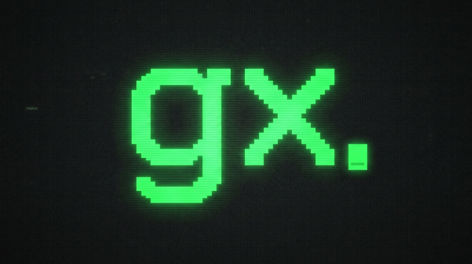

<div align="center">

<h1>
  
</h1>

**A fast git project manager.
Clone, jump, and organise repos from the terminal.**

[](https://github.com/joshuaboys/gx/actions/workflows/ci.yml)
[](LICENSE)
[](https://www.rust-lang.org)

</div>

---

## Features

- **Instant project switching** — jump to any repo by name with fuzzy matching
- **Structured organisation** — repos are cloned into a consistent `owner/repo` layout
- **GitHub shorthand** — `gx clone user/repo` just works
- **Shell integration** — tab completion and auto-`cd` for zsh, bash, fish, and PowerShell
- **Open in any editor** — `gx open` launches VS Code, nvim, or whatever you use
- **AI agent scaffolding** — `gx init` generates `.claude/` configs tailored to your project's language
- **Installation health checks** — `gx doctor` verifies the binary, shell integration, config, and index
- **Single binary** — no language runtime required; uses your installed Git

## Quick Start

Install [Git](https://git-scm.com/downloads) first. gx uses your existing Git
authentication for HTTPS and SSH repositories.

```sh
# Install (macOS / Linux)
curl -fsSL https://raw.githubusercontent.com/joshuaboys/gx/main/install.sh | sh
exec "$SHELL"   # reload to pick up PATH and shell integration

# Clone a repo and cd into it
gx clone joshuaboys/gx

# Jump back to the same repo later
gx gx
```

Windows PowerShell:

```powershell
irm https://raw.githubusercontent.com/joshuaboys/gx/main/install.ps1 | iex
```

Restart PowerShell after installation. The installers configure shell integration
and tab completion for the detected supported shell. Run `gx doctor` to check
the configuration; see [troubleshooting](#troubleshooting) if navigation does not work.

## Install

The installer downloads the `gx` binary (verifying its SHA-256 checksum), puts it on your `PATH`, and sets up shell integration with tab completion.

**macOS / Linux:**

```sh
curl -fsSL https://raw.githubusercontent.com/joshuaboys/gx/main/install.sh | sh
```

**Windows (PowerShell):**

```powershell
irm https://raw.githubusercontent.com/joshuaboys/gx/main/install.ps1 | iex
```

The Windows installer verifies `gx-windows-x64.exe` against the release `SHA256SUMS` manifest, installs it to `%LOCALAPPDATA%\gx\bin`, and adds that directory to your user `PATH`. x86_64 only; ARM64 Windows is not published yet.

Git Bash can use `eval "$(gx shell-init bash)"` once `gx.exe` is on `PATH`. WSL should use the Linux installer above.

> **Note:** Shell integration is required for `gx` to `cd` into projects. The installer sets this up automatically. If you installed manually, add `eval "$(gx shell-init)"` for bash/zsh, `gx shell-init | source` for fish, or `Invoke-Expression (& gx shell-init powershell | Out-String)` for PowerShell.

<details>
<summary><strong>Manual install</strong></summary>

Requires a [Rust](https://www.rust-lang.org/tools/install) toolchain (1.75+).

```sh
git clone https://github.com/joshuaboys/gx
cd gx
cargo build --release
mkdir -p ~/.local/bin
cp target/release/gx ~/.local/bin/
export PATH="$HOME/.local/bin:$PATH"
```

For Windows, run the clone and build commands above, then in PowerShell:

```powershell
$gxBinDir = Join-Path $env:LOCALAPPDATA 'gx\bin'
New-Item -ItemType Directory -Force $gxBinDir | Out-Null
Copy-Item target\release\gx.exe $gxBinDir
$env:Path = "$gxBinDir;$env:Path"
```

Persist the install directory in your user PATH (Windows Environment Variables)
or shell configuration (Unix), before the shell integration line. The PATH
commands above affect only the current session.

Add shell integration to your config file, creating the file and its parent
directory if necessary:

**zsh** (`~/.zshrc`) / **bash** (`~/.bashrc`):

```sh
eval "$(gx shell-init)"
```

**fish** (`~/.config/fish/conf.d/gx.fish`):

```fish
gx shell-init | source
```

**PowerShell** (`$PROFILE`):

```powershell
Invoke-Expression (& gx shell-init powershell | Out-String)
```

</details>

<details>
<summary><strong>oh-my-zsh (legacy)</strong></summary>

If you already use gx as an oh-my-zsh plugin, it still works:

```sh
ln -s /path/to/gx/plugin ~/.oh-my-zsh/custom/plugins/gx
# add gx to plugins=(...) in ~/.zshrc
```

The plugin file now delegates to `gx shell-init` internally.

</details>

## Usage

Run `gx --help` for the command list or `gx <command> --help` for command-specific
usage, for example `gx clone --help`.

### Already have repositories?

```sh
gx config set projectDir ~/code  # choose the root to scan
gx index                         # add repos found under that root
gx index /path/to/repo            # add a repo anywhere, including a worktree
gx ls
```

`gx index` is additive: it preserves existing entries. Explicit paths must point
to repository roots. Names come from directory basenames; if two repositories
have the same name, gx warns and replaces that name's index entry. Use distinct
directory names when you need to navigate to both.

### Jump to a project

```sh
gx myproject        # exact match
gx myproj           # fuzzy match fallback
```

Tab completion at `gx <name>` lists indexed project names. A sufficiently close,
unique fuzzy match jumps automatically. Otherwise gx prints suggestions and
exits unsuccessfully; rerun with an exact name, for example `gx myproject`.
The numbered suggestions are not an interactive menu.

### Return to recent work

```sh
gx recent          # projects ordered by last visit (or clone/index time)
gx recent -n 5     # show the five most recent
gx resume myproject # jump and show branch, dirty files and last commit
```

Resolving a name with `gx resolve` also records a visit, including in scripts.
`gx resume` needs shell integration to change the current directory.

### Use Git worktrees

```sh
gx myproject wt list
```

With shell integration and [Worktrunk](https://worktrunk.dev) installed, gx enters
the project and forwards the arguments after `wt` to Worktrunk. Worktrunk is
optional; ordinary gx navigation does not require it.

### Clone a repository

```sh
gx clone user/repo              # GitHub shorthand
gx clone https://github.com/user/repo
gx clone git@github.com:user/repo.git
```

Repositories are cloned to `~/Projects/src/<owner>/<repo>` by default and the shell `cd`s into the new directory.

#### One-off destinations

Pass an optional path to land a single clone outside the configured layout,
without changing any config:

```sh
gx clone user/repo put-it-here  # -> ./put-it-here
gx clone user/repo /tmp/scratch # -> /tmp/scratch
```

Relative paths resolve against the current directory, the same as `git clone`.
The clone is still indexed — under the destination's directory name, so
`gx put-it-here` jumps back to it. Everything else is unchanged: missing parent
directories are created, an existing clone at the destination is skipped, and
`projectDir` / `structure` are left alone.
If the destination already contains an unindexed repository, add it explicitly
with `gx index /path/to/destination`; skipping an existing clone does not index it.

### List projects

```sh
gx ls
```

### Open in editor

```sh
gx open myproject               # uses default editor
gx open myproject --editor code # override editor
gx open                         # open current directory
```

Editor resolution order: `--editor` flag > configured `editor` > `$VISUAL` >
`$EDITOR` > `nano` on Unix. Windows requires an explicitly configured editor
or environment variable. Set one with `gx config set editor code`.

### Scaffold AI agent config

```sh
gx init                    # auto-detect project type
gx init --type rust        # override detection
gx init --force            # overwrite the three generated files
```

Creates `.claude/CLAUDE.md` and `.claude/commands/` with plan and review slash commands. Supports project types: `typescript-bun`, `typescript-node`, `rust`, `go`, `python`, `generic`.

### Rebuild index

```sh
gx rebuild
```

Rescans the configured project directory and removes stale index entries within
that scope, preserving entries outside it. Use `gx index` to discover repositories
without pruning entries. Neither command moves or deletes your repositories.

### Check installation health

```sh
gx doctor
```

Reports whether the `gx` binary is on `PATH`, shell integration is configured, config/index paths exist, and indexed projects point at existing directories.

## Configuration

```sh
gx config                         # show current config
gx config set projectDir ~/code   # change project directory
gx config set structure flat      # use repo-only layout
gx config set structure owner     # use owner/repo layout (default)
gx config set structure host      # use host/owner/repo layout
gx config set editor code         # set default editor
```

Config is stored at `~/.config/gx/config.json`; the index is alongside it in
`index.json`. On native Windows these are under `%USERPROFILE%\.config\gx`.
Changing `projectDir` or `structure` affects future operations; it does not move
existing repositories.

| Key | Default | Purpose |
| --- | --- | --- |
| `projectDir` | `~/Projects/src` | Root for default clones and scans |
| `structure` | `owner` | `flat`, `owner`, or `host` directory layout |
| `defaultHost` | `github.com` | Host for shorthand clone URLs |
| `defaultOwner` | Empty | Owner for bare names, e.g. `gx clone gx` |
| `shallow` | `false` | Set to `true` to clone with `--depth=1` |
| `similarityThreshold` | `0.7` | Fuzzy candidate threshold from 0 to 1; automatic jumps also require a unique match scoring at least 0.85 |
| `editor` | Empty | Editor executable; otherwise use environment/default resolution above |

```sh
gx config set defaultOwner joshuaboys
gx config set defaultHost github.com
gx config set shallow true
```

`GX_AGENT=<name>` routes default clones and scans under `projectDir/.<name>`.
Names use letters, numbers and internal hyphens and are normalised to lowercase.
The index is shared; this is a directory convention, not a separate index or
security boundary. Explicit clone destinations bypass this routing.

### Directory structures

<table>
<tr><th><code>owner</code> (default)</th><th><code>flat</code></th><th><code>host</code></th></tr>
<tr>
<td>

```
~/Projects/src/
  owner/repo/
  owner/other-repo/
```

</td>
<td>

```
~/Projects/src/
  repo/
  other-repo/
```

</td>
<td>

```
~/Projects/src/
  github.com/owner/repo/
  gitlab.com/owner/other-repo/
```

</td>
</tr>
</table>

## Troubleshooting

- **`gx` is not found:** check that the install directory is on PATH before the
  shell integration line. Restart the shell after changing its configuration.
- **gx prints a path instead of changing directory:** load the wrapper for the
  shell you are actually using: `eval "$(gx shell-init bash)"`,
  `eval "$(gx shell-init zsh)"`, `gx shell-init fish | source`, or
  `Invoke-Expression (& gx shell-init powershell | Out-String)`.
- **A project is missing:** run `gx index /path/to/repo`, then `gx ls`.
- **A project was moved or removed:** run `gx doctor` to identify missing paths
  and `gx rebuild` to refresh the configured scope. Entries outside that scope
  are preserved; back up `index.json` before manually correcting them.
- **Cloning fails:** check Git authentication and the URL. gx uses the same
  credentials and SSH keys as `git clone`.

`gx doctor` checks shell configuration files; it cannot prove the wrapper is
loaded in the current terminal. It reports problems without repairing them.

## Uninstall

```sh
rm ~/.local/bin/gx
```

Remove the `# gx` integration block from your shell configuration (`~/.zshrc`,
`~/.bashrc`, the Bash login profile selected by the installer on macOS, or
`~/.config/fish/conf.d/gx.fish`). Keep shared PATH entries needed by other tools.

On Windows PowerShell:

```powershell
Remove-Item (Join-Path $env:LOCALAPPDATA 'gx\bin\gx.exe')
```

Remove the gx block from `$PROFILE` and the gx install directory from your user
PATH, then restart the shell. Config and index files under `~/.config/gx` are
retained; remove that directory separately if you want to reset gx. Your
repositories are unaffected.

## More

- [Use cases & examples](docs/use-cases.md) — real-world workflows, scripting recipes, and shell aliases
- [Contributing](CONTRIBUTING.md) — development setup and guidelines

## Acknowledgements

gx draws inspiration from these projects:

- **[ghq](https://github.com/x-motemen/ghq)** — the original structured repository manager. ghq pioneered the `host/owner/repo` directory layout and index-based project lookup that gx builds on.
- **[gclone](https://github.com/allonsy/gclone)** — a git clone helper with automatic directory organisation, shorthand URL parsing, and shell auto-cd. gx's clone workflow and shell integration owe a lot to gclone's approach.

## License

MIT
